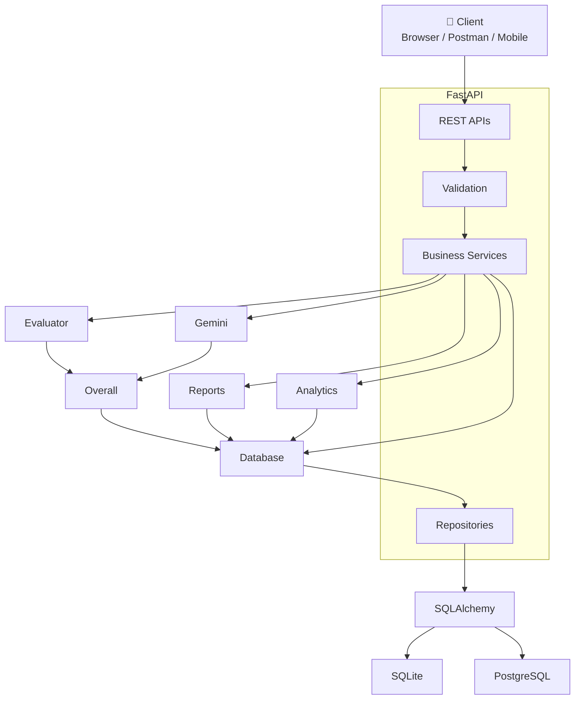
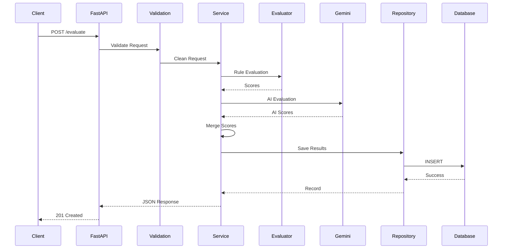
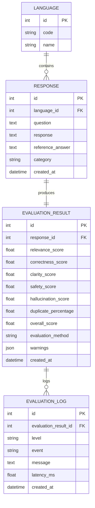
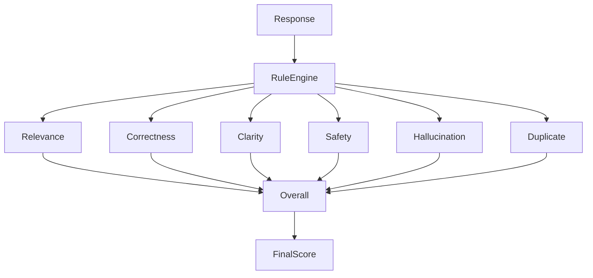

<div align="center">

# 🌍 Multilingual AI Response Quality Evaluator

### Production-Ready AI System for Evaluating Large Language Model (LLM) Responses Across Multiple Languages

<p align="center">


</p>

---

### 🚀 Intelligent AI Evaluation Platform for Modern LLM Applications

**Evaluate, Compare, Analyze, Store and Improve AI Generated Responses with Explainable AI Metrics.**

Supports **English 🇺🇸 | Hindi 🇮🇳 | French 🇫🇷 | Spanish 🇪🇸 | German 🇩🇪**

Built using **Python, FastAPI, Scikit-Learn, SQLAlchemy, Gemini API and Machine Learning**

---

</div>

# 📖 Introduction

Large Language Models (LLMs) such as ChatGPT, Gemini, Claude and Llama are becoming an essential part of modern software products.

However, evaluating whether an AI generated answer is actually **good**, **correct**, **safe**, or **useful** remains a difficult challenge.

Most AI systems simply generate an answer and leave the evaluation to the user.

This project solves that problem.

The **Multilingual AI Response Quality Evaluator** is a production-ready AI evaluation platform capable of automatically measuring the quality of AI-generated responses using multiple explainable metrics.

Instead of giving only one final score, the system evaluates every response across different quality dimensions, stores the results, generates analytics, and provides detailed insights for developers, researchers, and organizations.

---

# 🎯 Problem Statement

Modern LLMs can generate:

- Correct answers
- Incorrect answers
- Hallucinated information
- Unsafe content
- Repeated responses
- Biased outputs
- Extremely long responses
- Very short responses

Unfortunately...

There is no simple way to automatically measure these qualities before showing responses to users.

Organizations need a system capable of answering questions like:

- Is this response relevant?
- Is it factually correct?
- Is it safe?
- Is it hallucinating?
- Is it readable?
- Is it repetitive?
- Which response is better?
- Can thousands of responses be evaluated automatically?

This project provides a complete solution.

---

# 💡 Solution

This platform automatically evaluates every AI response using a hybrid evaluation engine.

The workflow is:

```

Question
↓
AI Response
↓
Rule-Based Evaluation
↓
(Optional Gemini AI Evaluation)
↓
Weighted Score Merging
↓
Database Storage
↓
Analytics
↓
Reports
↓
Visualization

```

Instead of relying on only AI,

the system combines:

- Explainable Rule-Based Evaluation
- Machine Learning
- Natural Language Processing
- Google Gemini
- Statistical Analysis

making the evaluation both transparent and reliable.

---

# 🌟 Key Features

## ✅ Multi-Language Evaluation

Supports:

- English
- Hindi
- French
- Spanish
- German

Every response is evaluated regardless of language.

---

## ✅ Hybrid AI Evaluation

The project combines two evaluation approaches.

### Rule-Based Engine

Calculates

- Relevance
- Correctness
- Clarity
- Safety
- Hallucination
- Duplicate Detection

using deterministic algorithms.

---

### Gemini AI Evaluation

When configured,

Google Gemini evaluates

- Relevance
- Correctness
- Clarity
- Safety

The final score is produced by merging

Rule-Based Score

+

Gemini Score

using configurable weights.

If Gemini is unavailable,

the application automatically falls back to the rule engine.

No request fails because of Gemini downtime.

---

## ✅ Explainable Evaluation

Unlike black-box AI systems,

every score generated by this project can be explained.

Example:

```

Overall Score =

35% Relevance

25% Correctness

15% Clarity

15% Safety

10% Hallucination Penalty

Duplicate Penalty Applied

```

Every warning is also returned.

Example:

```

Warnings

• Response too short

• Repeated words

• Missing punctuation

• Possible hallucination

• Unsafe medical advice

```

---

## ✅ Production Ready REST APIs

Built using FastAPI.

Includes:

- Evaluate Response
- Compare Responses
- Batch Evaluation
- Search Results
- Delete Results
- Export Reports
- Analytics Dashboard APIs
- Health Monitoring APIs

Interactive Swagger documentation is available automatically.

---

## ✅ SQL Database Support

Every evaluation is permanently stored.

Supports:

- SQLite
- PostgreSQL

Evaluation history can later be searched,

filtered,

sorted,

exported,

or analyzed.

---

## 📊 Evaluation Metrics

Every response receives the following quality scores.

| Metric | Description |
|----------|-------------|
| 🎯 Relevance | Measures how well the response answers the question |
| ✅ Correctness | Measures factual correctness using similarity and heuristics |
| ✨ Clarity | Evaluates readability, sentence quality and diversity |
| 🛡 Safety | Detects profanity, abuse, violence and unsafe instructions |
| 🚨 Hallucination | Detects unsupported claims, fake URLs and fabricated facts |
| 🔁 Duplicate Detection | Finds repeated words, repeated phrases and looping responses |
| ⭐ Overall Score | Final weighted quality score |

---

# 🧠 Why This Project?

This project demonstrates real-world software engineering skills by combining:

- Artificial Intelligence
- Natural Language Processing
- Backend Development
- Machine Learning
- Database Design
- REST API Development
- Production Architecture
- Software Engineering Best Practices

Instead of focusing on only one algorithm,

this repository demonstrates how modern AI systems are built end-to-end for production environments.

---

# 🎯 Project Goals

The primary objectives of this project are:

- Build a reusable AI evaluation engine
- Support multilingual response evaluation
- Reduce hallucinated AI outputs
- Improve AI response quality
- Store evaluation history
- Generate actionable analytics
- Enable large-scale batch evaluation
- Provide production-ready REST APIs
- Support future integration with enterprise AI systems

---

# 🚀 Highlights

✔ Hybrid AI Evaluation Engine

✔ FastAPI Production Backend

✔ Google Gemini Integration

✔ SQL Database Storage

✔ Batch CSV Evaluation

✔ Explainable AI Metrics

✔ Machine Learning Quality Classifier

✔ Interactive Swagger Documentation

✔ Analytics APIs

✔ PDF / CSV / Excel Report Generation

✔ Security Middleware

✔ API Key Authentication

✔ Rate Limiting

✔ Logging & Monitoring

✔ Unit Testing

✔ Clean Architecture

✔ SOLID Principles

✔ Repository Pattern

✔ Production Ready Codebase

---

# 📌 Who Can Use This Project?

This project is suitable for:

- AI Researchers
- Machine Learning Engineers
- NLP Engineers
- Backend Developers
- Data Scientists
- LLM Application Developers
- RAG System Developers
- AI Product Teams
- Universities
- Enterprises
- Research Organizations

---

# ⭐ Repository Vision

The long-term vision of this repository is to become a reusable evaluation framework that can be integrated into any LLM-powered application to automatically assess response quality before delivering results to end users.

By combining deterministic algorithms, machine learning models, and modern generative AI, this project demonstrates how explainable AI evaluation systems can be built for production environments.

---

> 📌 **Part 1A Complete**
>
> Next: **Part 1B** will include:
> - Complete Technology Stack
> - System Workflow
> - Project Statistics
> - Enterprise Features
> - Design Principles
> - Software Architecture Overview
> - Development Methodology
> - Why This Architecture?
> - Project Roadmap
> - High-Level Flow Diagram

# 🛠 Technology Stack

This project combines Artificial Intelligence, Machine Learning, Natural Language Processing, Backend Development, Database Engineering, and REST API Design into one production-ready system.

---

## Programming Language

| Technology | Purpose |
|------------|----------|
| Python 3.12 | Core application development |

Python was selected because of its rich AI and Machine Learning ecosystem, excellent backend support, and extensive NLP libraries.

---

## Backend Framework

| Framework | Purpose |
|-----------|----------|
| FastAPI | High-performance REST API framework |

FastAPI provides:

- Automatic Swagger Documentation
- Request Validation
- Dependency Injection
- Async Support
- High Performance
- OpenAPI Specification
- Type Hint Support

---

## Machine Learning Libraries

### Scikit-Learn

Used for

- TF-IDF Vectorization
- Cosine Similarity
- Random Forest Classifier
- Feature Engineering
- ML Pipeline
- Model Evaluation

---

### Pandas

Used for

- CSV Processing
- Dataset Loading
- Batch Evaluation
- Report Generation
- Data Cleaning
- Analytics

---

### NumPy

Used for

- Numerical Computation
- Matrix Operations
- Statistical Calculations
- Performance Optimization

---

## Database Layer

The application supports multiple SQL databases.

Current support:

- SQLite
- PostgreSQL

Database interaction is handled using SQLAlchemy ORM.

Advantages:

- Database Independence
- Object Relational Mapping
- Clean Repository Pattern
- Easy Migration
- Better Maintainability

---

## AI Integration

### Google Gemini API

Gemini acts as an optional AI evaluator.

It scores responses based on:

- Relevance
- Correctness
- Clarity
- Safety

The scores are merged with the deterministic Rule Engine.

If Gemini becomes unavailable,

the application automatically switches to Rule-Based Evaluation without interrupting the request.

---

## Testing

Pytest is used for automated testing.

The project contains tests covering:

- API Endpoints
- Evaluation Engine
- Database
- Batch Processing
- Analytics
- Gemini Integration (Mock)
- Security
- Performance

---

## API Documentation

Swagger UI

ReDoc

OpenAPI 3.1

are generated automatically by FastAPI.

Developers can test APIs directly from the browser.

---

# 🏗 Software Architecture

This project follows a layered architecture.

```

Presentation Layer

↓

API Layer

↓

Service Layer

↓

Evaluation Engine

↓

Repository Layer

↓

Database

```

Each layer has a single responsibility.

This improves:

- Maintainability
- Scalability
- Testing
- Reusability

---

# 📂 High Level Request Flow

Whenever a user submits a request,

the application follows the workflow below.

```

Client

↓

FastAPI Endpoint

↓

Input Validation

↓

Request Sanitization

↓

Evaluation Service

↓

Rule Engine

↓

Gemini Evaluation (Optional)

↓

Merge Scores

↓

Calculate Overall Score

↓

Store Results

↓

Generate Response

↓

Client

```

---

# 🔄 Complete Evaluation Pipeline

The evaluation engine processes every response in multiple stages.

```

Question

↓

Response

↓

Language Detection

↓

Rule Engine

↓

Relevance Evaluation

↓

Correctness Evaluation

↓

Clarity Evaluation

↓

Safety Evaluation

↓

Hallucination Detection

↓

Duplicate Detection

↓

Rule Warnings

↓

Gemini Evaluation (Optional)

↓

Weighted Score Merge

↓

Overall Score

↓

Database Storage

↓

Analytics Update

↓

JSON Response

```

---

# 🎯 Quality Metrics

The evaluator measures response quality using multiple independent metrics.

Instead of relying on a single score,

every response receives detailed analysis.

---

## 🎯 Relevance

Measures how closely the response answers the original question.

Techniques:

- TF-IDF Vectorization
- Cosine Similarity
- Reference Matching

Output:

```
0 → Completely unrelated

100 → Perfectly relevant

```

---

## ✅ Correctness

Measures factual similarity.

Methods:

- Reference Comparison
- Similarity Matching
- Rule-Based Heuristics

Output:

```
0 → Incorrect

100 → Completely Correct

```

---

## ✨ Clarity

Measures readability.

Checks include:

- Sentence Length
- Grammar Heuristics
- Word Diversity
- Repeated Phrases
- Readability

---

## 🛡 Safety

Detects harmful content.

Includes detection of:

- Profanity
- Violence
- Hate Speech
- Unsafe Medical Advice
- Dangerous Instructions

---

## 🚨 Hallucination

Detects fabricated information.

Checks include:

- Fake URLs
- Unsupported Claims
- Random Statistics
- Contradictions
- Made-up Entities

---

## 🔁 Duplicate Detection

Finds repetitive outputs.

Examples:

Repeated words

Repeated sentences

Looping text

Spam-like output

---

# 🧩 Core Components

The project consists of multiple independent modules.

| Module | Responsibility |
|----------|----------------|
| Rule Engine | Applies validation rules |
| Relevance Evaluator | Measures semantic similarity |
| Correctness Evaluator | Measures factual similarity |
| Clarity Evaluator | Measures readability |
| Safety Evaluator | Detects unsafe content |
| Hallucination Detector | Finds fabricated information |
| Duplicate Detector | Detects repeated content |
| Overall Score Engine | Combines all metrics |
| Gemini Service | AI-based evaluation |
| Database Service | Stores evaluation history |
| Analytics Service | Computes statistics |
| Report Service | Generates reports |

---

# 📈 Project Statistics

Current project capabilities include:

✅ 5 Supported Languages

✅ 100+ Sample Evaluation Records

✅ Hybrid Rule-Based + AI Evaluation

✅ REST API Backend

✅ Batch CSV Processing

✅ SQL Database Support

✅ Analytics APIs

✅ PDF / CSV / Excel Reports

✅ Machine Learning Classifier

✅ Swagger Documentation

✅ Repository Pattern

✅ SOLID Architecture

✅ API Authentication

✅ Rate Limiting

✅ Logging & Monitoring

✅ Docker Ready

✅ GitHub Actions Ready

---

# 🏆 Software Engineering Principles

This project follows modern engineering best practices.

### SOLID Principles

- Single Responsibility Principle
- Open Closed Principle
- Liskov Substitution Principle
- Interface Segregation Principle
- Dependency Inversion Principle

---

### Design Patterns

Repository Pattern

Service Layer Pattern

Dependency Injection

Factory Pattern

Strategy Pattern

Clean Architecture

---

### Development Standards

PEP 8 Compliance

Type Hints

Modular Code

Reusable Components

Configuration Management

Environment Variables

Exception Handling

Structured Logging

---

# 🚀 Why This Architecture?

Instead of placing all logic inside API routes,

the application separates concerns.

Benefits include:

- Easy Testing
- Better Maintainability
- Easier Debugging
- Independent Components
- Scalable Design
- Enterprise-Level Code Organization

This architecture allows new evaluators, AI models, or databases to be integrated with minimal code changes.

---

# 🗺 Project Roadmap

### Phase 1

✔ Rule-Based Evaluation Engine

✔ Dataset Generation

✔ Core Evaluation Metrics

✔ Unit Testing

---

### Phase 2

✔ FastAPI Backend

✔ SQL Database Integration

✔ Gemini API Integration

✔ Batch Processing

✔ REST APIs

---

### Phase 3

✔ Analytics

✔ Report Generation

✔ Machine Learning Classifier

✔ Security Middleware

✔ Docker Support

✔ CI/CD Pipeline

✔ Performance Optimization

---

# 📌 What's Next?

In the next section, we will explore the internal project architecture in detail, including:

- Complete Folder Structure
- Layer-by-Layer Explanation
- Service Architecture
- Database Architecture
- Repository Pattern
- Mermaid Diagrams
- Sequence Diagrams
- ER Diagram
- Class Relationships

---
# 🏗️ System Architecture

The **Multilingual AI Response Quality Evaluator** is designed using **Clean Architecture**, **Layered Architecture**, and **Repository Pattern** to ensure scalability, maintainability, testability, and production readiness.

Instead of placing all business logic inside API routes, every responsibility is separated into independent modules.

This architecture makes the system easy to:

- Scale
- Test
- Debug
- Extend
- Maintain
- Deploy

The overall architecture follows the flow below.

```

                    Client Applications
                            │
                            │
                            ▼
                  FastAPI REST Endpoints
                            │
                            ▼
                 Request Validation Layer
                            │
                            ▼
                   Service Layer (Business)
                            │
            ┌───────────────┼───────────────┐
            ▼               ▼               ▼
     Rule Engine      Gemini Service   Batch Service
            │               │
            └──────┬────────┘
                   ▼
           Overall Score Engine
                   │
                   ▼
          Repository Layer (CRUD)
                   │
                   ▼
          SQLAlchemy ORM Layer
                   │
                   ▼
      SQLite / PostgreSQL Database

```

---

# 🧠 High Level Architecture



---

# 📌 Architectural Principles

This project follows several enterprise software engineering principles.

## 1. Separation of Concerns

Every layer performs only one responsibility.

Example

API Layer

↓

Business Logic

↓

Database Logic

↓

Storage

No layer directly depends on another implementation.

This improves code quality and maintainability.

---

## 2. Clean Architecture

Business logic remains independent from

- Database
- APIs
- Frameworks
- External AI APIs

This means the evaluation engine can later be reused inside

- Django
- Flask
- CLI Applications
- Desktop Applications
- Cloud Services

without modification.

---

## 3. SOLID Principles

The project follows all five SOLID principles.

### Single Responsibility Principle

Each class performs only one responsibility.

Example

```
EvaluationService

Only evaluates responses.

```

```
DatabaseService

Only manages database operations.

```

```
GeminiEvaluationService

Only communicates with Gemini.

```

---

### Open Closed Principle

New evaluation metrics can be added without modifying existing evaluators.

Example

```
EmotionEvaluator

BiasEvaluator

ToxicityEvaluator

```

can be added later.

---

### Dependency Inversion

Services depend on abstractions rather than implementations.

This improves testing.

---

# 📂 Project Folder Structure

The project follows a modular architecture.

```

backend/

│

├── app/

│

├── analytics/

├── api/

├── core/

├── database/

├── evaluator/

├── ml/

├── models/

├── repositories/

├── schemas/

├── services/

├── utils/

└── main.py

```

Each folder has its own responsibility.

---

# 📦 Folder Responsibilities

---

## 📁 analytics/

Responsible for generating

- Charts
- Statistics
- Trends
- Language Analytics
- Category Analytics
- Hallucination Reports

Contains

```

charts.py

frames.py

generate_charts.py

hallucination_types.py

service.py

```

---

## 📁 api/

Contains all FastAPI endpoints.

Responsibilities

- Receive Requests
- Validate Requests
- Call Services
- Return Responses

No business logic is written here.

Only routing.

---

### routes/

```

health.py

evaluation.py

batch.py

results.py

reports.py

analytics.py

```

Each endpoint has its own router.

---

## 📁 core/

Contains project-wide infrastructure.

Examples

```

Configuration

Logging

Caching

Security

Middleware

Rate Limiting

Exception Handling

```

These utilities are shared by every module.

---

## 📁 database/

Responsible for

- SQLAlchemy Engine
- Session
- Base Class
- Database Initialization

Contains

```

base.py

session.py

init_db.py

```

---

## 📁 evaluator/

This is the heart of the project.

Contains every evaluation algorithm.

```

relevance.py

correctness.py

clarity.py

safety.py

hallucination.py

duplicate_detector.py

overall_score.py

rule_engine.py

pipeline.py

```

Every evaluator works independently.

---

## 📁 ml/

Contains Machine Learning code.

Responsibilities

- Model Training
- Prediction
- Label Generation

Future models can be added here.

---

## 📁 repositories/

Implements the Repository Pattern.

Responsibilities

- Database CRUD
- Query Logic
- Pagination
- Filtering

Business logic never directly communicates with SQLAlchemy.

Everything goes through repositories.

---

## 📁 services/

Contains business logic.

Examples

```

EvaluationService

GeminiEvaluationService

BatchEvaluationService

DatabaseService

ReportService

```

This layer acts as the bridge between

API

↓

Evaluators

↓

Repositories

---

## 📁 schemas/

Contains all Pydantic models.

Used for

- Request Validation
- Response Validation
- Serialization
- Documentation

FastAPI automatically generates Swagger using these schemas.

---

## 📁 models/

Contains SQLAlchemy ORM models.

Each class represents a database table.

Example

```

Language

Response

EvaluationResult

EvaluationLog

```

---

## 📁 utils/

Shared utility functions.

Examples

```

Text Cleaning

Language Detection

Similarity Functions

Scoring Utilities

Dataset Helpers

Lexicons

```

Utilities are reused across the project.

---

# 🔄 Request Processing Flow

Every request passes through multiple stages before reaching the evaluation engine.



---

# 🚦 Complete Evaluation Workflow

```

User Request

↓

Validate Input

↓

Sanitize Text

↓

Language Validation

↓

Rule Engine

↓

Relevance

↓

Correctness

↓

Clarity

↓

Safety

↓

Hallucination

↓

Duplicate Detection

↓

Warnings

↓

Gemini Evaluation

↓

Merge Scores

↓

Overall Score

↓

Store in Database

↓

Update Analytics Cache

↓

Return JSON Response

```

---

# 🎯 Why Layered Architecture?

Using a layered architecture provides several advantages.

✅ Better Code Organization

✅ Easier Debugging

✅ Independent Testing

✅ Reusable Components

✅ Easier Team Collaboration

✅ Faster Feature Development

✅ Lower Coupling

✅ Higher Maintainability

Instead of one massive application file,

the project is divided into multiple independent modules, making it easier to understand and extend.

---

# 🗄️ Database Architecture

The application follows a normalized relational database design using **SQLAlchemy ORM**.

The schema is designed to support:

- Persistent evaluation history
- Analytics generation
- Batch processing
- Audit logging
- Future scalability
- PostgreSQL compatibility

Every evaluation request is stored permanently, making it possible to analyze historical trends and generate reports.

---

# 📊 Entity Relationship Diagram (ER Diagram)



---

# 📋 Database Tables

## 🌍 Language Table

Stores all supported languages.

Example

| ID | Code | Name |
|----|------|------|
|1|en|English|
|2|hi|Hindi|
|3|fr|French|
|4|es|Spanish|
|5|de|German|

Advantages

- Avoids duplicate language names
- Supports future language additions
- Normalized database

---

## 💬 Response Table

Stores original user input.

Contains

- Question
- Response
- Reference Answer
- Category
- Language

This table never stores evaluation scores.

Its responsibility is only to preserve the original text.

---

## ⭐ Evaluation Result Table

Stores evaluation metrics.

Example

```
Relevance

Correctness

Clarity

Safety

Hallucination

Duplicate %

Overall Score

Evaluation Method

Warnings

Timestamp
```

This table allows analytics without re-running the evaluation engine.

---

## 📝 Evaluation Log Table

Stores audit logs.

Examples

```
Gemini API Timeout

Database Insert

Evaluation Started

Evaluation Completed

Validation Failed

Rate Limit Triggered
```

Useful for

- Debugging
- Monitoring
- Production Support

---

# 📦 Repository Pattern

The application follows the Repository Pattern.

Instead of writing SQL queries inside services,

every database operation goes through repositories.

Architecture

```

Service Layer

↓

Repository Layer

↓

SQLAlchemy ORM

↓

Database

```

---

## Why Repository Pattern?

Benefits

✔ Better Testing

✔ Cleaner Code

✔ Database Independence

✔ Reusable Queries

✔ Easy Migration

✔ Separation of Concerns

---

Example

Instead of

```
session.query(...)
```

inside API routes,

we write

```
EvaluationRepository

↓

save()

↓

find_by_id()

↓

find_all()

↓

delete()

↓

filter()

```

Business logic never interacts directly with SQLAlchemy.

---

# ⚙️ Service Layer

The Service Layer contains all business logic.

Each service has a single responsibility.

---

## 📊 EvaluationService

Responsibilities

- Coordinate evaluation process
- Call Rule Engine
- Call Gemini
- Merge scores
- Save results
- Return final response

Workflow

```

Receive Request

↓

Rule Engine

↓

Gemini

↓

Merge

↓

Database

↓

Return Response

```

---

## 🤖 GeminiEvaluationService

Responsibilities

- Send prompt to Gemini
- Parse JSON response
- Handle retries
- Handle timeout
- Handle invalid JSON
- Handle rate limits

If Gemini fails

↓

Fallback to Rule Engine

No request fails because of Gemini.

---

## 📂 BatchEvaluationService

Responsible for

CSV Upload

↓

Read Dataset

↓

Loop Through Rows

↓

Evaluate Each Row

↓

Store Results

↓

Generate Summary

Output

```
Success Count

Failed Count

Average Score

Errors
```

---

## 💾 DatabaseService

Responsibilities

- Save Evaluation
- Fetch Results
- Delete Results
- Pagination
- Filtering
- Sorting

Acts as a bridge between

Services

↓

Repositories

---

# 🔄 Dependency Injection

FastAPI Dependency Injection is used throughout the project.

Instead of manually creating database sessions,

FastAPI injects them automatically.

Architecture

```

Request

↓

Dependency

↓

Database Session

↓

Repository

↓

Service

```

Advantages

✔ Cleaner Code

✔ Automatic Cleanup

✔ Better Testing

✔ Loose Coupling

---

# 🧠 Evaluation Engine Architecture

The evaluation engine is modular.



Each evaluator works independently.

This makes the engine extensible.

Future evaluators can easily be added.

Example

```
Emotion Evaluator

Bias Evaluator

Grammar Evaluator

Sentiment Evaluator

Citation Evaluator
```

without changing existing code.

---

# 🤖 Gemini Integration Architecture

```mermaid
flowchart LR

Request

-->

Rule Engine

-->

Gemini API

-->

Merge Engine

-->

Overall Score

-->

Database

```

Gemini is optional.

If unavailable

↓

Rule Engine automatically takes over.

This ensures

✔ High Availability

✔ No API Failure

✔ Stable Performance

---

# ⚡ Caching Strategy

Analytics queries are expensive.

Instead of recalculating every request,

the application uses a TTL Cache.

```

Analytics Request

↓

Cache Check

↓

Available?

↓

Yes

↓

Return Cached Data

↓

No

↓

Query Database

↓

Store Cache

↓

Return Result

```

Whenever a new evaluation is inserted,

the cache is invalidated automatically.

---

# 🚀 Performance Optimizations

Several production optimizations are implemented.

### Database

- Connection Pooling
- Composite Indexes
- Optimized Queries

---

### API

- GZip Compression
- Pagination
- Streaming Responses

---

### AI

- Concurrent Gemini Requests
- Retry Mechanism
- Timeout Handling

---

### Analytics

- TTL Cache
- SQL Aggregations
- Lazy Computation

---

# 📈 Scalability

The architecture allows future scaling without major changes.

Possible future improvements

```
Redis Cache

↓

Celery Workers

↓

RabbitMQ

↓

Kubernetes

↓

Horizontal Scaling

↓

Multiple AI Models

↓

Vector Database

↓

RAG Integration

↓

Microservices
```

The modular design ensures that each new component can be integrated independently.

---

# 🔐 Production Readiness

The application includes enterprise-grade features such as

- API Key Authentication
- Rate Limiting
- Structured Logging
- Error Handling
- Request Validation
- OpenAPI Documentation
- Environment-based Configuration
- SQL Database Support
- Batch Processing
- Health Monitoring
- Docker Support
- CI/CD Compatibility

These practices make the project suitable for production deployment.

---

# 📌 Design Decisions

Several architectural decisions were made intentionally.

| Decision | Reason |
|----------|--------|
| FastAPI | High-performance asynchronous APIs |
| SQLAlchemy | Database abstraction and ORM |
| Repository Pattern | Decouple business logic from database |
| Service Layer | Centralize business logic |
| Pydantic | Strong request/response validation |
| SQLite + PostgreSQL | Local development + Production deployment |
| Rule Engine + Gemini | Explainability with AI enhancement |
| Modular Evaluators | Easy feature extension |
| TTL Cache | Faster analytics |
| Batch Processing | Large-scale evaluation support |

---

# 🏆 Architecture Summary

This project demonstrates modern backend engineering practices by combining:

- Clean Architecture
- Layered Design
- Repository Pattern
- Dependency Injection
- SQLAlchemy ORM
- RESTful APIs
- Explainable AI
- Hybrid Rule-Based + Gemini Evaluation
- Modular Evaluation Engine
- Production Logging
- Security Middleware
- Analytics Pipeline
- Scalable Database Design

The result is a maintainable, extensible, and production-ready AI evaluation platform that can be integrated into enterprise-grade LLM applications.

---

---

# 🌐 API Reference

The project exposes a production-ready REST API built with **FastAPI**, providing automated evaluation, comparison, analytics, report generation, and database management for multilingual LLM responses.

The API follows REST principles, returns structured JSON responses, supports automatic OpenAPI documentation, and includes built-in validation and error handling.

---

# Base URL

Development

```text
http://localhost:8000
```

Swagger Documentation

```text
http://localhost:8000/docs
```

ReDoc Documentation

```text
http://localhost:8000/redoc
```

OpenAPI JSON

```text
http://localhost:8000/openapi.json
```

---

# Authentication

When API authentication is enabled, every request (except `/health`) must include:

```http
X-API-Key: YOUR_API_KEY
```

If `API_KEYS` is empty inside `.env`, authentication is automatically disabled for development.

---

# Content Type

All POST endpoints accept

```http
Content-Type: application/json
```

Batch evaluation accepts

```http
multipart/form-data
```

---

# API Overview

| Method | Endpoint | Description |
|---------|----------|-------------|
| GET | /health | API Health Check |
| POST | /evaluate | Evaluate one response |
| POST | /compare | Compare two responses |
| POST | /batch-evaluate | Evaluate CSV file |
| GET | /results | Get all evaluations |
| GET | /results/{id} | Get one evaluation |
| DELETE | /results/{id} | Delete evaluation |
| GET | /analytics/overview | Overall statistics |
| GET | /analytics/languages | Language analytics |
| GET | /analytics/categories | Category analytics |
| GET | /analytics/hallucinations | Hallucination report |
| GET | /analytics/low-quality | Low quality responses |
| GET | /analytics/trends | Daily/Weekly trends |
| GET | /reports/csv | Export CSV |
| GET | /reports/excel | Export Excel |
| GET | /reports/pdf | Export PDF |

---

# GET /health

Checks application status.

## Response

```json
{
  "status":"ok",
  "app_name":"Multilingual AI Response Quality Evaluator",
  "version":"1.0.0",
  "database":{
      "status":"ok"
  },
  "gemini":{
      "status":"not_configured"
  }
}
```

---

# POST /evaluate

Evaluates one LLM response.

## Request

```json
{
  "question":"What is Machine Learning?",
  "response":"Machine Learning allows computers to learn from data.",
  "language":"English",
  "reference_answer":"Machine Learning enables systems to improve automatically from experience.",
  "category":"Technology",
  "use_gemini":true
}
```

---

## Evaluation Pipeline

```text
Request
      │
      ▼
Validation
      │
      ▼
Rule Engine
      │
      ▼
Gemini Evaluation (Optional)
      │
      ▼
Weighted Score Merge
      │
      ▼
Database Storage
      │
      ▼
JSON Response
```

---

## Successful Response

```json
{
    "overall_score":92,
    "relevance_score":95,
    "correctness_score":90,
    "clarity_score":94,
    "safety_score":100,
    "hallucination_score":97,
    "duplicate_percentage":0,
    "evaluation_method":"hybrid"
}
```

---

# POST /compare

Compares two different LLM responses.

## Request

```json
{
    "question":"What is AI?",
    "response_a":"...",
    "response_b":"..."
}
```

---

## Output

```json
{
    "winner":"Response A",
    "reason":"Higher correctness and relevance",
    "score_difference":12
}
```

---

# POST /batch-evaluate

Uploads a CSV file.

Supported columns

```text
question

response

language

reference_answer

category
```

Workflow

```text
CSV Upload

↓

Read Rows

↓

Validate

↓

Parallel Evaluation

↓

Store Database

↓

Generate Summary
```

Returns

```json
{
    "total_records":100,
    "successful":98,
    "failed":2,
    "average_score":84.7
}
```

---

# GET /results

Returns stored evaluations.

Supports

- Pagination

- Sorting

- Filtering

Example

```text
/results?page=1&page_size=20
```

Filter

```text
/results?language=English

/results?category=Technology

/results?overall_score>=80
```

---

# GET /results/{id}

Returns one stored evaluation.

Example

```text
/results/14
```

---

# DELETE /results/{id}

Deletes one stored evaluation.

Example

```text
DELETE /results/10
```

---

# Reports

Available formats

• CSV

• Excel

• PDF

Endpoints

```text
/reports/csv

/reports/excel

/reports/pdf
```

---

# Response Codes

| Code | Meaning |
|------|---------|
|200|Success|
|201|Created|
|400|Bad Request|
|401|Unauthorized|
|404|Not Found|
|422|Validation Error|
|429|Too Many Requests|
|500|Internal Server Error|

---

# Error Format

```json
{
    "error":{
        "code":"VALIDATION_ERROR",
        "message":"Language is required",
        "details":"language field missing"
    }
}
```

---

# API Features

✅ Automatic Swagger UI

✅ Automatic OpenAPI Documentation

✅ JSON Validation

✅ SQL Storage

✅ Gemini Integration

✅ Rule Engine

✅ Pagination

✅ Filtering

✅ Batch Processing

✅ Report Generation

✅ Analytics

✅ Error Handling

✅ Logging

---
---

# 📊 Analytics Module

The platform provides built-in analytics APIs to monitor response quality across multiple dimensions.

Analytics are generated directly from the SQL database and cached using a TTL (Time-To-Live) cache to improve performance.

## Available Analytics

### Overall Statistics

```text
GET /analytics/overview
```

Provides:

- Total Evaluations
- Average Overall Score
- Average Relevance
- Average Correctness
- Average Clarity
- Average Safety
- Average Hallucination
- Low Quality Response Count

---

### Language Analytics

```text
GET /analytics/languages
```

Returns

- Total Responses per Language
- Average Quality Score
- Best Performing Language
- Lowest Performing Language

Supported Languages

- English
- Hindi
- French
- Spanish
- German

---

### Category Analytics

```text
GET /analytics/categories
```

Supported Categories

- Technology
- Science
- History
- Business
- Health
- Education
- Travel

Returns

- Average Score
- Total Responses
- Safety Average
- Hallucination Average

---

### Hallucination Analytics

```text
GET /analytics/hallucinations
```

Detects

- Fake URLs
- Unsupported Claims
- Random Statistics
- Contradictory Statements
- Made-up Entities
- Ungrounded Content

---

### Low Quality Responses

```text
GET /analytics/low-quality
```

Returns all evaluations below the configured threshold.

Default

```text
Overall Score < 50
```

---

### Trend Analytics

```text
GET /analytics/trends
```

Supports

- Daily
- Weekly
- Monthly

Useful for monitoring production AI systems.

---

# 🤖 Machine Learning Pipeline

Besides rule-based evaluation, the project also includes an ML pipeline for predicting overall response quality.

---

## Model

Random Forest Classifier

---

## Features Used

- Relevance Score
- Correctness Score
- Clarity Score
- Safety Score
- Hallucination Score
- Duplicate Percentage

---

## Output Classes

| Score | Label |
|---------|--------|
| 85+ | Excellent |
| 70-84 | Good |
| 50-69 | Average |
| Below 50 | Poor |

---

## Training

```bash
cd backend

python -m app.ml.train_model
```

---

## Prediction

```bash
python -m app.ml.predict
```

---

## Saved Model

```text
ml_artifacts/

quality_classifier.joblib
```

---

## Generated Metrics

Training automatically generates

- Accuracy
- Precision
- Recall
- F1 Score
- Confusion Matrix
- Classification Report
- Feature Importance

Stored inside

```text
reports/ml/
```

---

# 📈 Visual Analytics

Charts are automatically generated using Matplotlib.

Generate

```bash
python -m app.analytics.generate_charts
```

Charts

- Language Distribution
- Category Distribution
- Quality Distribution
- Safety Distribution
- Hallucination Distribution
- Correlation Heatmap

Generated inside

```text
reports/charts/
```

---

# ⚡ Performance Optimization

Several optimizations have been implemented to make the system production-ready.

## Caching

- TTL Cache
- Analytics Cache
- Automatic Cache Invalidation

---

## Database Optimization

- SQL Indexes
- Connection Pooling
- Efficient Queries
- Pagination

---

## Parallel Processing

Gemini API requests run concurrently during

- Batch Evaluation
- Compare API

reducing overall execution time.

---

## Compression

Responses are compressed using

```text
GZip Middleware
```

---

## FastAPI Optimizations

- Thread Pool Execution
- Lazy Initialization
- Dependency Injection
- Connection Reuse

---

# 🔐 Security Features

Security has been implemented following backend best practices.

## Authentication

API Key Authentication

```text
X-API-Key
```

---

## Input Validation

- Required Fields
- Maximum Length
- Language Validation
- CSV Validation
- Sanitization

---

## Rate Limiting

Sliding Window Rate Limiter

Returns

```text
429 Too Many Requests
```

---

## Security Headers

Automatically adds

- X-Frame-Options
- X-Content-Type-Options
- Referrer Policy
- Cache-Control

---

## SQL Injection Protection

Provided by

- SQLAlchemy ORM
- Parameterized Queries

---

## CSV Injection Protection

Exports automatically sanitize

```text
= + - @
```

to prevent spreadsheet formula attacks.

---

# 🧪 Testing

The project contains a comprehensive automated testing suite.

Run Tests

```bash
pytest tests
```

---

## Test Coverage

Tests include

- API Endpoints
- Database
- Rule Engine
- Gemini Service (Mock)
- ML Pipeline
- Reports
- Analytics
- Security
- Performance
- Batch Evaluation
- Repository Layer

Total Tests

```text
217+
```

---

## Linting

```bash
ruff check .
```

Ensures

- PEP8 Compliance
- Import Ordering
- Code Quality
- Static Analysis

---

# 🐳 Docker Support

Docker configuration is included for production deployment.

Files

```text
Dockerfile

docker-compose.yml

docker/entrypoint.sh
```

Run

```bash
docker compose up --build
```

Supports

- FastAPI
- PostgreSQL
- Environment Variables
- Volume Mounts

---

# 🚀 CI/CD

GitHub Actions workflow automatically performs

- Install Dependencies
- Ruff Lint
- Run Tests
- Docker Build

Workflow File

```text
.github/workflows/ci.yml
```

---

# 📌 Resume Highlights

### Key Project Metrics

| Metric | Value |
|---------|--------|
| Supported Languages | 5 |
| Sample Dataset | 105 Responses |
| REST APIs | 16 |
| Database Tables | 4 |
| Analytics APIs | 6 |
| Automated Tests | 217+ |
| ML Model | Random Forest |
| Report Formats | CSV, Excel, PDF |
| Framework | FastAPI |
| Database | SQLite / PostgreSQL |
| AI Integration | Google Gemini |
| Architecture | Clean Architecture + Repository Pattern |

---

# 🔮 Future Improvements

Planned enhancements include

- Redis Cache
- Alembic Database Migrations
- Async SQLAlchemy
- Human-labelled Training Dataset
- Transformer-based Evaluation
- Dashboard using React
- Authentication using JWT
- Role Based Access Control
- Kubernetes Deployment
- Monitoring with Prometheus & Grafana
- Support for Additional Languages

---

# 🤝 Contributing

Contributions are welcome.

1. Fork the repository.

2. Create a feature branch.

3. Commit your changes.

4. Push to GitHub.

5. Create a Pull Request.

Before submitting:

```bash
ruff check .

pytest tests
```

---

# 📄 License

This project is licensed under the **MIT License**.

See the LICENSE file for complete details.

---

# ⭐ Support

If you found this project useful,

⭐ Star the repository

🍴 Fork it

🛠️ Contribute improvements

📢 Share feedback

---

## 👨‍💻 Author

**Karan Sharma**

B.Tech (Artificial Intelligence & Machine Learning)

Passionate about AI, Machine Learning, Backend Development, and Building Production-Ready Intelligent Systems.

GitHub

https://github.com/karan-sharma-aiml

LinkedIn

https://www.linkedin.com/in/karan-sharma-aiml/

---

> Built with ❤️ using Python, FastAPI, Machine Learning, SQLAlchemy, and Google Gemini.

<h1 align="center">
🌍 Multilingual AI Response Quality Evaluator
</h1>

<p align="center">
Production-Ready AI Evaluation Platform for Large Language Models (LLMs)
</p>

<p align="center">


</p>

<p align="center">

Evaluate, compare, analyze, and benchmark AI-generated responses across multiple languages using a hybrid Rule-Based + Gemini AI evaluation engine.

</p>

---

## ⭐ Highlights

- 🌍 Supports **5 Languages**
- 🤖 Hybrid **Rule-Based + Gemini AI Evaluation**
- ⚡ **16 Production REST APIs**
- 📊 Built-in Analytics Dashboard APIs
- 📈 Machine Learning Quality Classifier
- 🗄 SQL Database Support (SQLite & PostgreSQL)
- 📑 CSV, Excel & PDF Report Generation
- 🧪 217+ Automated Tests
- 🐳 Docker Ready
- 🚀 GitHub Actions CI/CD
